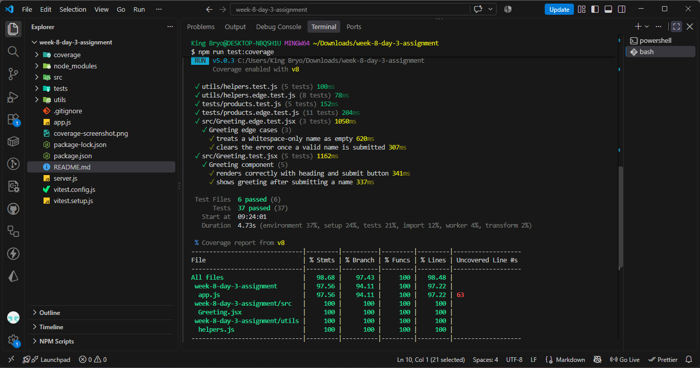

# Week 8 Day 3 Assignment: Testing with Vitest

Unit tests, API tests (Supertest) and React component tests (React Testing Library).

## Setup

```bash
npm install
npm run test:run        # run all tests once
npm run test:coverage   # run tests with coverage
npm start               # start the API on http://localhost:3000
```

## Structure

| Path | Purpose |
| --- | --- |
| `utils/helpers.js` | 5 utility functions |
| `utils/helpers.test.js` | Task 1: 5 unit tests |
| `app.js` / `server.js` | Express app (exported) / server startup (`listen`) |
| `tests/products.test.js` | Task 2: 5 Supertest API tests |
| `src/Greeting.jsx` | React component |
| `src/Greeting.test.jsx` | Task 3: 5 React Testing Library tests |
| `*.edge.test.js(x)` | Bonus: extra edge-case tests for coverage |

## Test results

- Required tests: 15 (5 + 5 + 5), all passing
- Including bonus edge-case tests: 37 total, all passing

## Bonus: coverage


